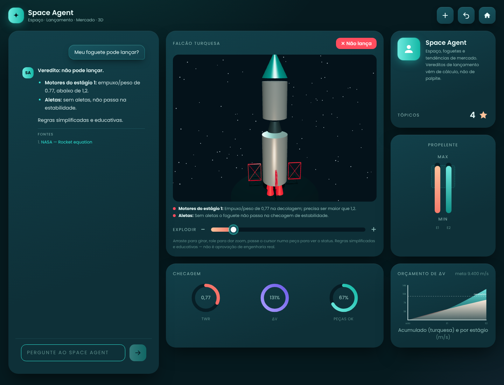

# Space Agent — análise da estrutura

Análise do PRD *Space AI Agent* e do kit de UI de referência, e como o projeto
desta pasta foi organizado a partir deles.



## 1. O que o produto é

Um web app com duas metades que conversam entre si:

| Metade | O que faz | Quem decide |
|---|---|---|
| **Chat** | Conversa em vários turnos sobre 4 temas | Claude (texto e raciocínio) |
| **Visualizador 3D** | Foguete feito de primitivas; peças reprovadas em vermelho | Código determinístico |

O princípio central do PRD guia toda a arquitetura: **o Claude conversa e
raciocina; o código faz a conta e desenha.** O modelo nunca dá veredito de
lançamento de cabeça — ele extrai as especificações e chama uma ferramenta.

### Os quatro temas

| # | Tema | Mecanismo | Saída |
|---|---|---|---|
| 1 | Espaço e astronomia | `web_search` (servidor da Anthropic) para o que é recente | Texto com fontes citadas |
| 2 | Checagem de lançamento | `check_launch` (função TypeScript local) | Veredito + métricas + status por peça |
| 3 | Marketing e economia | `web_search` sempre antes de responder | Resumo, fatores, fontes |
| 4 | Foguete 3D | `show_rocket` (local) → navegador | Modelo que o visualizador desenha |

### Fora do escopo (v1)

Física realista, contas de usuário, banco de dados, app nativo e modelos
fotorrealistas. O app é responsivo, mas é web.

## 2. Arquitetura

```
Navegador ──────────────────────────────────────────────────────────────┐
  useSpaceAgent (histórico no cliente)                                   │
    │ POST /api/chat  { messages }                                       │
    ▼                                                                    │
app/api/chat/route.ts  ── valida (zod) ── devolve NDJSON em streaming ───┤
    │                                                                    │
    ▼                                                                    │
lib/agent.ts  — loop do agente                                           │
  1. manda conversa + system prompt + ferramentas ao Claude              │
  2. tool_use? executa no código (check_launch / show_rocket)            │
  3. devolve tool_result                                                 │
  4. repete até a resposta final  (pause_turn → retoma a busca)          │
    │                                                                    │
    └── eventos: text · status · launch · rocket · sources · error · done┘
```

### Decisões e por quê

- **Loop manual em vez do tool runner do SDK.** O loop precisa mandar eventos
  ao navegador no meio do caminho (o resultado da checagem e o modelo 3D saem
  *antes* do texto final) e tratar `pause_turn` da busca. O loop manual deixa
  isso explícito e sem dependência de API beta do runner.
- **NDJSON em vez de SSE.** Um JSON por linha, lido com `TextDecoderStream`.
  Não precisa de biblioteca e é fácil de testar. O PRD pede
  `{ text, rocketModel? }`; aqui o mesmo conteúdo chega em pedaços.
- **Histórico só no cliente.** Sem banco (não-objetivo do PRD). O navegador
  reenvia as últimas 40 mensagens a cada pergunta; o servidor é sem estado.
- **`show_rocket` herda a última checagem do mesmo turno.** O modelo não
  repassa a lista de peças — o servidor liga `show_rocket` ao resultado de
  `check_launch`. Assim o vermelho no 3D é sempre o que o cálculo disse, e o
  modelo não tem como “pintar” uma peça por conta própria.
- **Entrada das ferramentas validada duas vezes.** O schema JSON enviado ao
  Claude sai do mesmo schema zod que valida a entrada no servidor
  (`z.toJSONSchema`). Entrada inválida volta ao modelo como `is_error`, e ele
  pede o dado que falta ao usuário.
- **Modelo `claude-sonnet-5-5`**, como o PRD pede, com esforço `medium`
  (bom para chat com ferramentas) e `fallbacks: "default"`: se o modelo
  recusar por política, o servidor da Anthropic tenta o substituto recomendado.
- **Busca limitada a 3 por turno** (`max_uses`) — risco de custo/latência
  apontado no PRD.

## 3. Contratos

### 3.1 `check_launch` — entrada

```ts
{
  name: string,
  stages: [{ dryMassKg, propellantMassKg, thrustN, ispSeconds, engineCount }], // 1 a 4
  payloadMassKg: number,
  targetOrbit: "LEO" | "GTO" | "Moon",
  hasFins: boolean,
  fuelTankCapacityKg?: number
}
```

### 3.2 As cinco regras (`lib/tools/checkLaunch.ts`)

| # | Regra | Conta | Limite | Peça que falha |
|---|---|---|---|---|
| 1 | Empuxo/peso na decolagem | `TWR = thrust₁ / (massa_total · 9,81)` | `> 1,2` | `stage-1-engines` |
| 2 | Orçamento de Δv | `Σ Isp · 9,81 · ln(m₀/m_f)` por estágio | LEO 9.400 · GTO 11.800 · Lua 12.500 m/s | todos os `stage-N-tank` |
| 3 | Fração de propelente | `prop / (seca + prop)` | entre 0,5 e 0,95 | o `stage-N-tank` daquele estágio |
| 4 | Estabilidade | `hasFins === false` reprova | — | `fins` |
| 5 | Capacidade do tanque | propelente do estágio ≤ capacidade | se informado | o `stage-N-tank` daquele estágio |

Detalhes de interpretação (o PRD deixa em aberto):

- No Δv, `m₀` de um estágio é a massa dele **mais todos os de cima e a carga**;
  `m_f` é `m₀` menos o propelente dele.
- A regra 5 vale **por tanque**: cada estágio é comparado com a capacidade.
- Quando uma peça falha em mais de uma regra, os motivos são concatenados.
- As aletas sempre entram na lista de peças. Sem aletas, o 3D desenha
  “aletas-fantasma” em vermelho, em wireframe, mostrando o que falta.

### 3.3 `check_launch` — saída

```ts
{
  canLaunch: boolean,
  summary: string,
  metrics: { twr, deltaVMs, requiredDeltaVMs, stageDeltaVMs[], propellantFractions[] },
  parts: [{ id, label, status: "ok" | "fail", reason? }]
}
```

`stageDeltaVMs` e `propellantFractions` são extensões ao PRD: alimentam o
gráfico de Δv e o medidor de propelente do painel.

### 3.4 IDs de peça (ligação cálculo ↔ 3D)

`nose` · `stage-N-tank` · `stage-N-engines` · `fins`, gerados num só lugar
(`lib/parts.ts`) e usados pelos dois lados.

### 3.5 Eventos do stream

| Evento | Quando | Efeito na tela |
|---|---|---|
| `status` | Começou uma busca ou ferramenta | Linha “Pesquisando na web…” com pontinhos |
| `text` | Cada pedaço de texto | Resposta vai aparecendo |
| `launch` | `check_launch` terminou | Anéis, medidor e gráfico se atualizam |
| `rocket` | `show_rocket` terminou | Foguete troca no 3D, pílula de veredito |
| `sources` | Fim, se houve busca | Lista “Fontes” sob a resposta |
| `error` | Recusa, corte ou falha da API | Aviso vermelho na mensagem |
| `done` | Fim | Libera o campo de envio |

## 4. Estrutura de pastas

```
space-agent/
  app/
    layout.tsx               # fonte, metadados, tema
    page.tsx                 # monta chat + visualizador + painel
    globals.css              # tokens do design system (Tailwind v4 @theme)
    api/chat/route.ts        # valida, chama o agente, devolve NDJSON
  components/
    useSpaceAgent.ts         # estado: histórico, streaming, foguete, checagem
    Chat.tsx                 # mensagens, sugestões, fontes, campo de envio
    Markdown.tsx             # negrito, listas, links nas respostas
    RocketViewer.tsx         # react-three-fiber: primitivas, hover, OrbitControls
    Dashboard.tsx            # cartões: anéis, propelente, Δv, agente
    ui/                      # primitivas do design system
      Card · IconButton · Button · Chip · StatPill
      DonutGauge · MeterBars · Slider · AreaChart · icons
  lib/
    agent.ts                 # loop + despacho das ferramentas
    schemas.ts               # schemas zod e tipos compartilhados
    parts.ts                 # IDs e lista de peças
    systemPrompt.ts
    tools/checkLaunch.ts
    tools/showRocket.ts
  tests/checkLaunch.test.ts  # Vitest: cada regra + showRocket
  docs/                      # esta análise e o design system
  CLAUDE.md                  # contexto do projeto para o Claude Code
```

## 5. Telas e estados

Uma tela só, em grade:

| Área | Desktop (≥1280px) | Celular |
|---|---|---|
| Cabeçalho | Marca + 3 botões de ícone (nova conversa, refazer, recentralizar) | Igual, quebra linha |
| Chat | Coluna esquerda fixa (sticky), altura da janela | Primeiro bloco, 70% da altura |
| Visualizador | Centro, ocupa 2 linhas | Depois do chat |
| Agente + Propelente | Coluna direita | Empilhados |
| Checagem + Δv | Linha de baixo | Empilhados |

Estados cobertos:

- **Vazio:** chat com 4 sugestões (uma por tema); foguete de demonstração
  neutro; painel com “—” e gráfico esmaecido.
- **Carregando:** linha de status com o que está acontecendo; botão de envio
  vira botão de parar (coral).
- **Sucesso:** texto em streaming, fontes, pílula “✓ Pode lançar”.
- **Reprovado:** pílula “✕ Não lança”, peças pulsando em vermelho, lista das
  falhas sob o 3D, anéis em vermelho quando o limite não é atingido.
- **Erro:** aviso vermelho dentro da mensagem (chave inválida, limite de
  requisições, rede, recusa); “refazer” repete a última pergunta.
- **Movimento reduzido:** animações desligadas via `prefers-reduced-motion`.

## 6. Do kit de UI para o app

Cada peça do kit de referência ganhou uma função:

| Componente do kit | Onde está no app |
|---|---|
| Gráfico de área com pílula de valor | Orçamento de Δv; pílula de veredito no visualizador |
| Anéis 45% / 60% / 75% | TWR, Δv atingido, peças aprovadas |
| Botões de ícone quadrados | Ações do cabeçalho |
| Campos USERNAME / PASSWORD | Campo de mensagem (placeholder em caixa alta espaçada) |
| Botão LOGIN em gradiente | Botão de enviar (turquesa) e de parar (pêssego) |
| Barras MAX / MIN | Fração de propelente por estágio, com a faixa 50–95% |
| Cartão de perfil com nota | Cartão do Space Agent (“Tópicos 4 ★”) |
| Slider com − / + | Vista explodida do foguete |

Os tokens e a troca de cor estão em [`DESIGN-SYSTEM.md`](DESIGN-SYSTEM.md).

## 7. Marcos

| Marco | Entrega | Situação |
|---|---|---|
| M1 | Next.js + TS + Tailwind, chat com streaming, histórico | Feito |
| M2 | `web_search` no loop, prompt pede fontes | Feito |
| M3 | `checkLaunch` com as 5 regras + testes Vitest | Feito (12 testes) |
| M4 | `RocketViewer` com primitivas, OrbitControls, vermelho na falha | Feito |
| M5 | `show_rocket`, API devolve o modelo, tela atualiza | Feito |
| M6 | Carregamento, erros, tooltip, responsivo, README | Feito |

## 8. Critérios de aceite

| Critério do PRD | Como verificar |
|---|---|
| Conversa de 5 turnos mantém contexto | Histórico inteiro vai em cada requisição (`useSpaceAgent`) |
| “Qual é a missão tripulada mais recente?” com fonte | `web_search` + lista de fontes sob a resposta |
| TWR 0,9 → `canLaunch: false`, motores reprovados | Teste `regra 1: TWR 0,9…` |
| “Maiores tendências econômicas agora?” com fonte | Prompt obriga busca antes; fontes listadas |
| Falha deixa a peça certa vermelha no 3D | IDs compartilhados + `show_rocket` herda a checagem |
| Testes do `checkLaunch` passam | `npm test` |
| Roda com `npm run dev` só com `ANTHROPIC_API_KEY` | `.env.local`; rota avisa se a chave faltar |
| Chave fora do repositório | `.env*.local` no `.gitignore`; `.env.example` sem valor |

## 9. Riscos e próximos passos

- **Especificação incompleta:** o prompt manda perguntar em vez de inventar, e
  o schema zod barra entradas sem os campos obrigatórios.
- **Física simplificada:** todo veredito vem com o aviso de que é educativo.
- **Custo da busca:** `max_uses: 3` por turno e esforço `medium`.
- **Histórico longo:** só as últimas 40 mensagens vão ao servidor.
- **Ideias futuras (do PRD):** órbita visualizada, mais modelos de foguete,
  salvar projetos, estabilidade real (centro de massa × centro de pressão).
